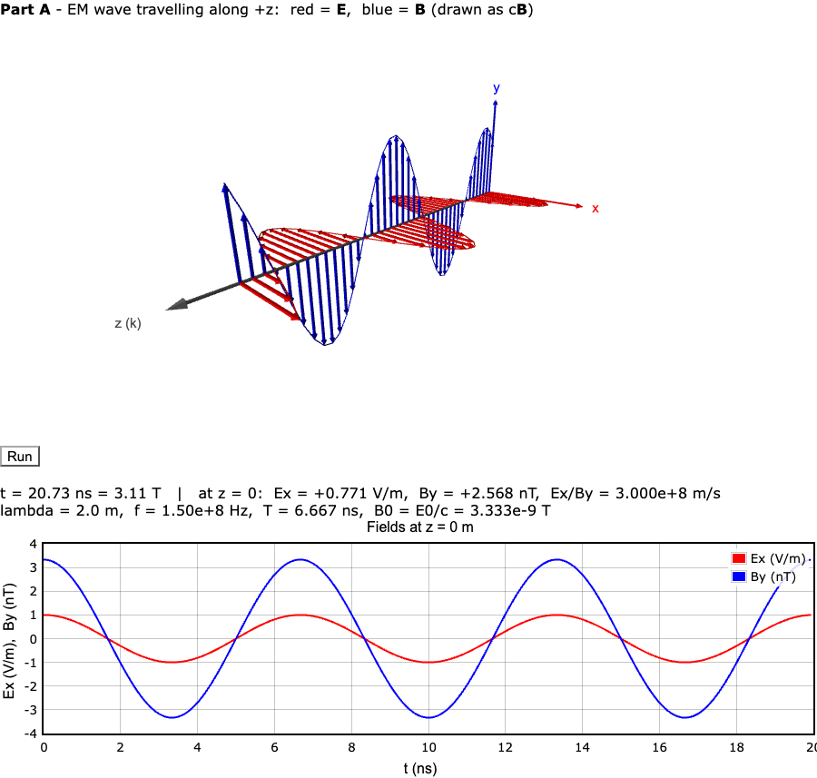
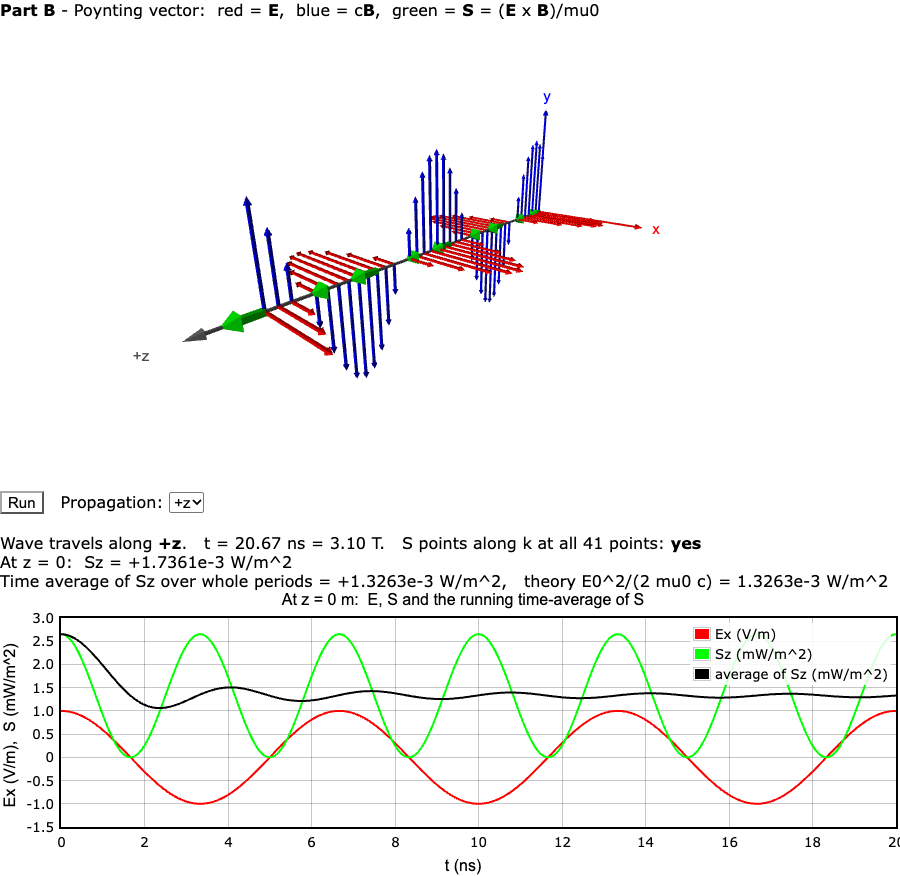
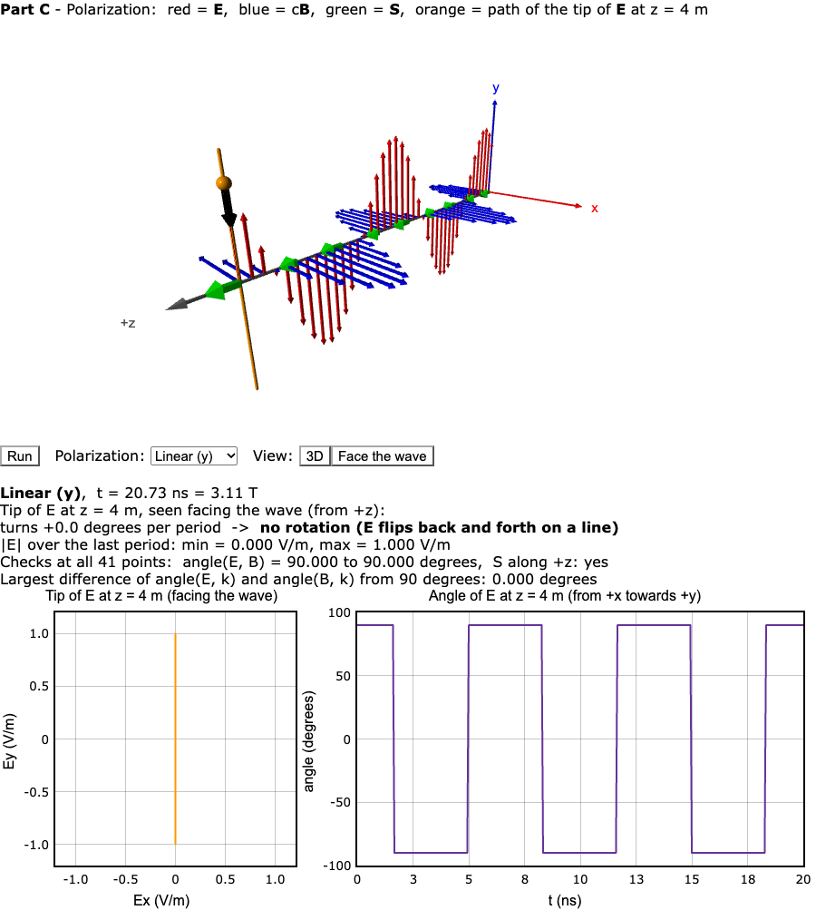
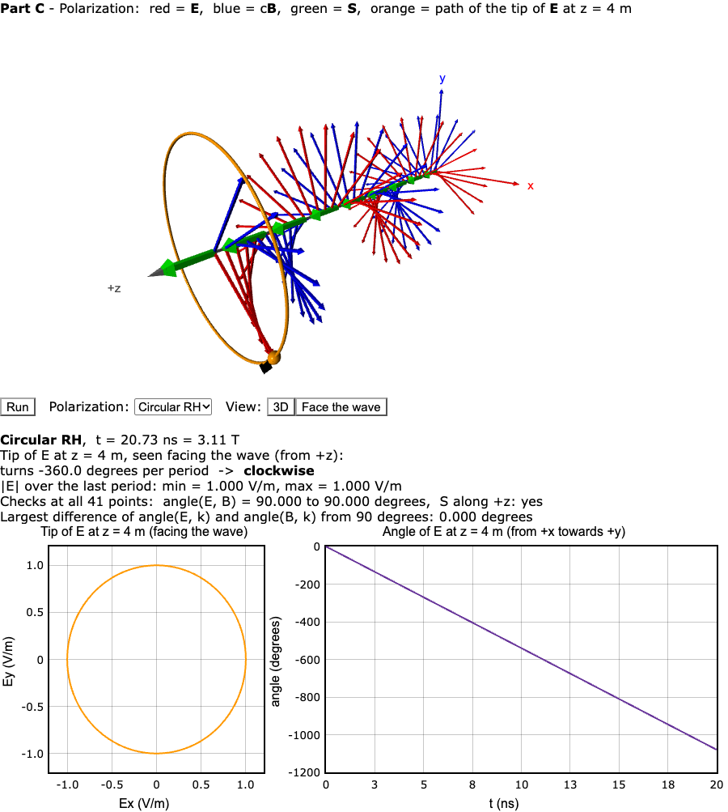
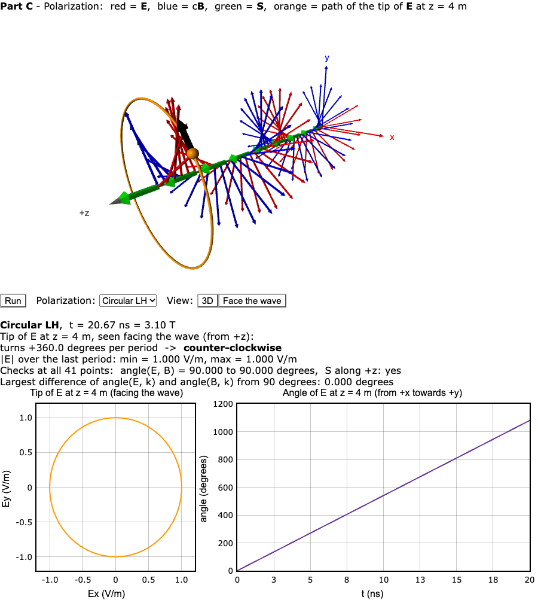
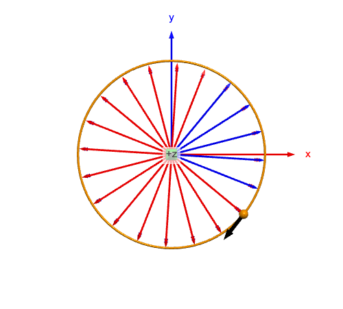
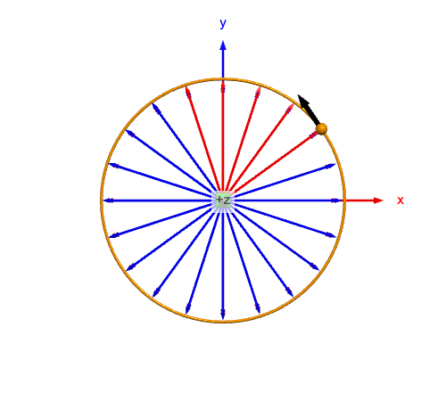
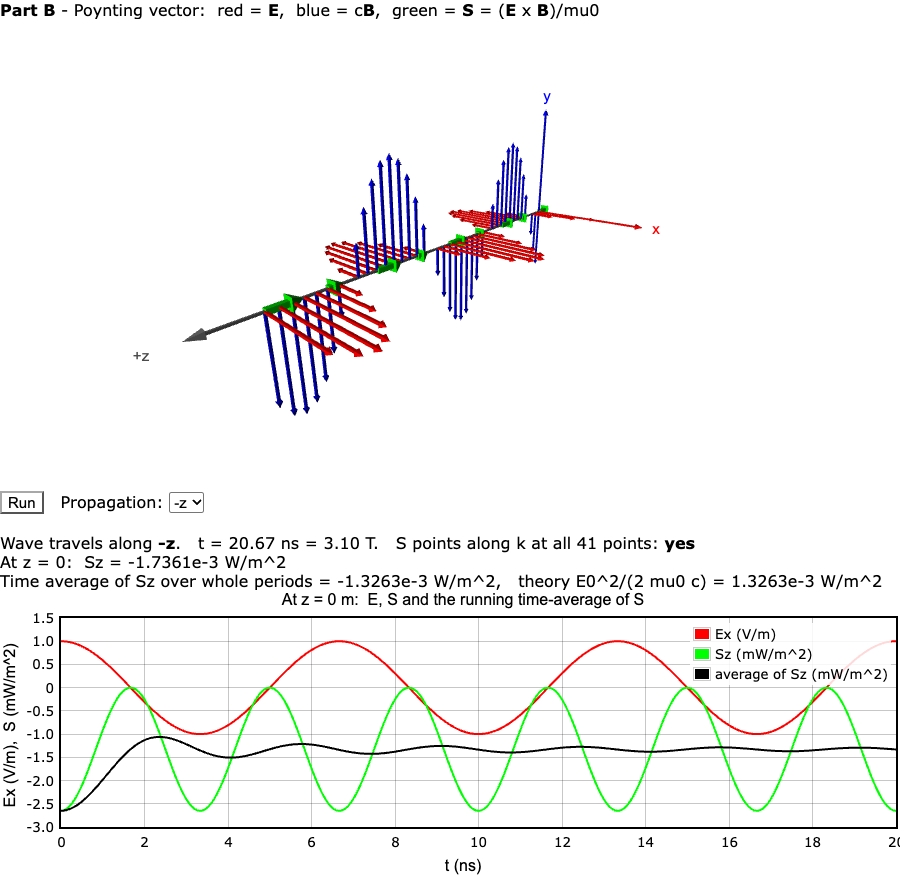

# SCI-103 Physics I – Lab 13 Report

**Visualization of Electromagnetic (EM) Fields using VPython**

---

## 1. Achievement

จาก Lab 13 ผมเขียนโปรแกรม Web VPython 3.2 จำนวน 3 โปรแกรม (Part A–C) เพื่อจำลองคลื่นแม่เหล็กไฟฟ้าระนาบ (plane EM wave) ในที่ว่าง และใช้ทั้งภาพ 3 มิติ กราฟ และตัวเลขที่โปรแกรมคำนวณ ตรวจกับทฤษฎี

- **Part A – คลื่น EM:** E อยู่ตามแกน x, B อยู่ตามแกน y, คลื่นเคลื่อนที่ตาม +z กราฟ E(t) และ B(t) ที่ z = 0 ผ่านศูนย์และถึงยอดพร้อมกัน แสดงว่ามีเฟสตรงกัน และอัตราส่วนที่วัดได้คือ E/B = 3.000×10⁸ m/s = c (สมการ 4–7)
- **Part B – Poynting vector:** ลูกศร S = (E × B)/μ₀ ชี้ +z ทั้ง 41 จุดตลอดเวลา ค่า S เต้นด้วยความถี่ 2f และค่าเฉลี่ยตามเวลาที่โปรแกรมคำนวณได้คือ 1.3263×10⁻³ W/m² ตรงกับทฤษฎี E₀²/(2μ₀c) (สมการ 8–10)
- **Part C – Polarization:** linear (y), circular RH และ circular LH โปรแกรมวัดการหมุนของปลาย E ได้ −360° ต่อคาบ (RH หมุนตามเข็มนาฬิกา) และ +360° ต่อคาบ (LH หมุนทวนเข็มนาฬิกา) เมื่อมองหันหน้าเข้าหาคลื่น (สมการ 11–13)
- **คำถามข้อ 5:** เมนู Propagation ใน Part B ทำให้คลื่นเคลื่อนที่ไปทาง −z ได้ และ S กลับทิศเป็น −z ตามที่ควรเป็น (สมการ 14)

ต่างจากการแก้แบบใช้ c = 1 โปรแกรมชุดนี้ **ยังใช้ค่า SI ตามใบงานทุกค่า** (c = 3×10⁸ m/s, λ = 2 m, B₀ = 3.33×10⁻⁹ T) แต่แก้ปัญหา 2 ข้อของโค้ดใบงาน (ข้อ 3.1) ด้วยการตั้งค่าการแสดงผลเพียง 2 บรรทัด คือ วาดลูกศร B เป็น c·B และใช้ Δt = T/100 (slow motion) ตัวเลขทุกตัวในโปรแกรมจึงเป็นหน่วยจริง

---

## 2. GlowScript URL (Shared)

### Part A
https://www.glowscript.org/#/user/yamaalluddin9470/folder/LAB13/program/LAB13PartA

### Part B
https://www.glowscript.org/#/user/yamaalluddin9470/folder/LAB13/program/LAB13PartB

### Part C
https://www.glowscript.org/#/user/yamaalluddin9470/folder/LAB13/program/LAB13PartC

โค้ด (Web VPython 3.2):

- [partA_em_wave.py](partA_em_wave.py) – Part A: ลูกศร E และ B + กราฟ E(t), B(t) ที่ z = 0
- [partB_poynting.py](partB_poynting.py) – Part B: Poynting vector + ค่าเฉลี่ย ⟨S⟩ + เมนูเลือกทิศ +z / −z (คำถามข้อ 5)
- [partC_polarization.py](partC_polarization.py) – Part C: linear (y), circular RH, circular LH + เส้นทางและมุมของปลาย E

---

## 3. Results

ภาพทั้งหมดในรายงานนี้จับจากการรันโปรแกรมด้วย GlowScript 3.2 (คอมไพเลอร์และไลบรารี `glow.3.2` ชุดเดียวกับที่ glowscript.org ใช้) บน Google Chrome ตัวเลขที่อ้างถึงอ่านจากข้อความที่โปรแกรมแสดงใต้ภาพ

### ค่าพารามิเตอร์ที่ใช้

| พารามิเตอร์ | โค้ดตามใบงาน | โปรแกรมของผม |
|---|---|---|
| c | 3×10⁸ m/s | 3×10⁸ m/s (เหมือนเดิม) |
| μ₀ | – | 4π×10⁻⁷ T·m/A |
| λ | 2.0 m | 2.0 m |
| f = c/λ | 1.5×10⁸ Hz | 1.5×10⁸ Hz |
| T = 1/f | 6.67×10⁻⁹ s | 6.67×10⁻⁹ s = 6.67 ns |
| ω = 2πf | 9.42×10⁸ rad/s | 9.42×10⁸ rad/s |
| k = 2π/λ | π rad/m | π rad/m |
| E₀ | 1.0 V/m | 1.0 V/m |
| B₀ = E₀/c | 3.33×10⁻⁹ T | 3.33×10⁻⁹ T |
| จุดตัวอย่างตามแกน z | N = 25, dz = 0.2 m | N = 41, dz = 0.1 m (z = 0–4 m = 2λ) |
| Δt ต่อเฟรม | 0.02 s, `rate(30)` | **T/100 = 6.67×10⁻¹¹ s**, `rate(50)` |
| ความยาวลูกศร B | B (ยาว 3.33×10⁻⁹ หน่วย) | **c·B** (ยาว 1 หน่วยเมื่อ B = B₀) |
| ความยาวลูกศร S | ยาว 0.5 เท่ากันหมด (normalize) | แปรผันตาม \|S\| ยาวสุด 0.45 m |

---

### 3.1 ปัญหาที่พบเมื่อรันโค้ดตามใบงาน


*รูปที่ 1: ผลการรันโค้ด Part A ตามใบงาน (ไม่แก้ไข) เห็นเฉพาะลูกศรสีแดง (E) ส่วนเส้นสีน้ำเงินที่เห็นคือแกน y ไม่ใช่ลูกศร B*

**ปัญหาที่ 1 – มองไม่เห็นลูกศร B:** โค้ดกำหนด

$$
B_0 = \frac{E_0}{c} = \frac{1.0}{3\times10^{8}} = 3.33\times10^{-9}\ \text{T} \tag{1}
$$

ลูกศร B จึงยาวเพียง 3.33×10⁻⁹ หน่วย เทียบกับลูกศร E ที่ยาว 1 หน่วย บนหน้าจอจึงมองไม่เห็น

**ปัญหาที่ 2 – คลื่นค้างนิ่ง:** ในแต่ละเฟรม เฟสของคลื่นเปลี่ยนไป

$$
\omega\,\Delta t = (9.42\times10^{8})(0.02) = 1.88\times10^{7}\ \text{rad} = 2\pi \times 3\,000\,000 \tag{2}
$$

คือคลื่นเดินหน้าไปพอดี 3 ล้านคาบต่อเฟรม ทุกเฟรมจึงกลับมาที่รูปเดิม (stroboscopic effect / aliasing) ผมตรวจโดยจับภาพ 2 ภาพห่างกัน 1.5 วินาทีแล้วเทียบทีละพิกเซล พบว่า **ต่างกัน 0 พิกเซล จาก 400,000 พิกเซล** คือภาพไม่เปลี่ยนเลย

**วิธีแก้ (ยังใช้ค่า SI เดิม):**

1. **วาดลูกศร B เป็น c·B** (`B_scale = c`): เนื่องจาก E = cB ปริมาณ c·B มีหน่วยเดียวกับ E (V/m) ลูกศร B จึงยาวเท่าลูกศร E เมื่อ B = B₀ ส่วนค่าที่โปรแกรมคำนวณและแสดงเป็นตัวเลขยังเป็นหน่วยเทสลา (T)
2. **ใช้ Δt เท่ากับ 1/100 ของคาบ:**

$$
\Delta t = \frac{T}{100} = 6.67\times10^{-11}\ \text{s}, \qquad \omega\,\Delta t = \frac{2\pi}{100} = 3.6^\circ \text{ ต่อเฟรม} \tag{3}
$$

ด้วย `rate(50)` คลื่น 1 คาบ (6.67 ns) ใช้เวลาบนจอ 2 วินาที คือภาพช้าลงประมาณ 3×10⁸ เท่า (slow motion) แกนเวลาของกราฟทุกรูปจึงเป็นเวลาจริงในหน่วยนาโนวินาที (ns)

---

### Part A: การแสดงคลื่น EM ด้วยลูกศรเคลื่อนไหว

คลื่นระนาบที่เคลื่อนที่ไปทาง +z ในที่ว่าง:

$$
\mathbf{E}(z,t) = E_0 \cos(kz - \omega t)\,\hat{\mathbf{x}} \tag{4}
$$

$$
\mathbf{B}(z,t) = B_0 \cos(kz - \omega t)\,\hat{\mathbf{y}} \tag{5}
$$

$$
k = \frac{2\pi}{\lambda}, \qquad \omega = 2\pi f \tag{6}
$$

$$
c = \frac{E_0}{B_0} = \lambda f = \frac{\omega}{k} \tag{7}
$$

โดยที่ **E** คือสนามไฟฟ้า (V/m), **B** คือสนามแม่เหล็ก (T), E₀ และ B₀ คือแอมพลิจูด, k คือเลขคลื่น (rad/m), λ คือความยาวคลื่น (m), ω คือความถี่เชิงมุม (rad/s), f คือความถี่ (Hz) และ c คืออัตราเร็วแสง



*รูปที่ 2: Part A ที่ t = 20.73 ns (3.11 คาบ) ลูกศรสีแดง = E (แกน x), สีน้ำเงิน = B วาดเป็น c·B (แกน y), แกนสีเทา = z (ทิศ k) กราฟด้านล่างคือ Ex (V/m) และ By (nT) ที่ z = 0 ในช่วง 3 คาบแรก*

**สิ่งที่เห็นและค่าที่วัดได้**

1. **E ⊥ B ⊥ k:** ลูกศร E อยู่ในระนาบ xz และลูกศร B อยู่ในระนาบ yz ทุกจุด จึงตั้งฉากกันและตั้งฉากกับแกน z ตามสมการ (4)–(5)
2. **เฟสตรงกัน:** ในกราฟ Ex และ By ผ่านศูนย์พร้อมกัน (t ≈ 1.67, 5.00, 8.33 ns …) และถึงยอดพร้อมกัน (t = 0, 6.67, 13.3 ns) ในภาพ 3 มิติจุดที่ E สูงสุด B ก็สูงสุด
3. **E/B = c:** ที่ t = 20.73 ns โปรแกรมแสดง Ex = +0.771 V/m, By = +2.568 nT และ **Ex/By = 3.000×10⁸ m/s** ตรงกับสมการ (7)
4. **λ = 2 m:** ในช่วง z = 0 ถึง 4 m มีคลื่นครบ 2 ลูกพอดี และในกราฟ 1 คาบใช้เวลา 6.67 ns = 1/f
5. ลูกศรที่อยู่ใกล้กล้องดูใหญ่กว่า เป็นผลจากมุมมองแบบ perspective ไม่ได้มาจากค่าของสนาม

---

### Part B: การแสดง Poynting Vector

Poynting vector บอกทิศและอัตราการไหลของพลังงานต่อหน่วยพื้นที่:

$$
\mathbf{S} = \frac{1}{\mu_0}\,(\mathbf{E} \times \mathbf{B}) \tag{8}
$$

แทนสมการ (4)–(5) และใช้ x̂ × ŷ = ẑ:

$$
\mathbf{S}(z,t) = \frac{E_0 B_0}{\mu_0}\cos^{2}(kz - \omega t)\,\hat{\mathbf{z}} \tag{9}
$$

ค่าเฉลี่ยตามเวลา (ค่าเฉลี่ยของ cos² = ½) คือความเข้มของคลื่น (intensity):

$$
\langle S \rangle = \frac{E_0 B_0}{2\mu_0} = \frac{E_0^{2}}{2\mu_0 c} = \frac{1}{2(4\pi\times10^{-7})(3\times10^{8})} = 1.3263\times10^{-3}\ \text{W/m}^2 \tag{10}
$$

ในโปรแกรม ลูกศร S (เขียว) ยาวแปรผันตาม |S| จริง (ไม่ normalize แบบใบงาน) และวาดทุก 5 จุดเพื่อไม่ให้ลูกศรซ้อนกัน



*รูปที่ 3: Part B ลูกศรสีเขียวบนแกน z คือ S ชี้ไปทาง +z กราฟ: แดง = Ex (V/m), เขียว = Sz (mW/m²), ดำ = ค่าเฉลี่ยสะสมของ Sz (mW/m²)*

**ผลเทียบกับทฤษฎี**

| ปริมาณ | จากการจำลอง | จากทฤษฎี |
|---|---|---|
| ทิศของ S | +z ทั้ง 41 จุด ทุกเฟรม ("S points along k: yes") | +z (x̂ × ŷ = ẑ) |
| S สูงสุด | 2.65 mW/m² (ยอดกราฟสีเขียว) | E₀B₀/μ₀ = 2.6526×10⁻³ W/m² |
| Sz ที่ z = 0, t = 3.10T | 1.7361×10⁻³ W/m² | 2.6526×10⁻³ × cos²(36°) = 1.7361×10⁻³ W/m² |
| คาบของ Sz | 3.33 ns (ยอดที่ t = 0, 3.33, 6.67, … ns) | T/2 = 3.33 ns (ความถี่ 2f) |
| ⟨S⟩ เฉลี่ยครบคาบ | **1.3263×10⁻³ W/m²** | **1.3263×10⁻³ W/m²** (สมการ 10) |

**สิ่งที่เห็นจากภาพ**

1. Sz ไม่เคยติดลบ (เส้นสีเขียวอยู่ระหว่าง 0 ถึง 2.65) เพราะ cos² ≥ 0 พลังงานจึงไหลไปทาง +z อย่างเดียว
2. Ex ครบ 1 คาบ Sz ถึงยอด 2 ครั้ง (ตอน E สูงสุดและต่ำสุด) เพราะ cos²θ = (1 + cos 2θ)/2
3. ค่าเฉลี่ยสะสม (เส้นดำ) แกว่งช่วงแรกแล้วเข้าใกล้ 1.33 mW/m² เมื่อเวลาผ่านไปหลายคาบ
4. ค่าเฉลี่ยตรงกับทฤษฎีทุกหลักเพราะโปรแกรมเฉลี่ยจาก 100 จุดที่ห่างเท่ากันในหนึ่งคาบ ซึ่งให้ค่าเฉลี่ยของ cos² = ½ พอดี จึงเป็นการยืนยันว่าโค้ดคำนวณสมการ (9) ถูกต้อง ไม่ใช่การวัดจากการทดลองจริง

---

### Part C: Polarization แบบต่าง ๆ

สนามแม่เหล็กหาได้จากสนามไฟฟ้าและทิศการเคลื่อนที่ k̂ (ทั้ง 3 โหมดใช้สมการนี้ในโค้ด):

$$
\mathbf{B} = \frac{1}{c}\,\hat{\mathbf{k}} \times \mathbf{E} \tag{11}
$$

**Linear ตามแกน y:** ใช้ ẑ × ŷ = −x̂

$$
\mathbf{E} = E_0\cos\phi\;\hat{\mathbf{y}}, \qquad
\mathbf{B} = -\frac{E_0}{c}\cos\phi\;\hat{\mathbf{x}}, \qquad \phi = kz - \omega t \tag{12}
$$

**Circular (RH ใช้เครื่องหมาย +, LH ใช้เครื่องหมาย −):**

$$
\mathbf{E} = E_0\left(\cos\phi\;\hat{\mathbf{x}} \pm \sin\phi\;\hat{\mathbf{y}}\right), \qquad |\mathbf{E}| = E_0 \ \text{(คงที่)} \tag{13}
$$

ลูกบอลสีส้มติดตามปลายของ E ที่ z = 4 m (จุดที่ใกล้กล้องที่สุด) และทิ้งรอยไว้ 1 คาบ ลูกศรสีดำเล็กที่ลูกบอลบอกทิศที่ปลาย E กำลังเคลื่อนที่ โปรแกรมยังวัด **มุมของ E** (วัดจาก +x ไปทาง +y เมื่อมองหันหน้าเข้าหาคลื่นจาก +z ซึ่ง x อยู่ทางขวาและ y อยู่ด้านบน) แล้วรายงานว่าในหนึ่งคาบมุมเปลี่ยนไปกี่องศา



*รูปที่ 4: Linear (y) – E (แดง) อยู่ตามแกน y, B (น้ำเงิน) อยู่ตามแกน x ปลาย E เคลื่อนที่ขึ้นลงบนเส้นตรง (กราฟซ้าย) และมุมของ E กระโดดระหว่าง +90° กับ −90° (กราฟขวา)*



*รูปที่ 5: Circular RH – ลูกศร E และ B เรียงเป็นเกลียว (helix) รอบแกน z ปลาย E เป็นวงกลม (กราฟซ้าย) และมุมลดลงเป็นเส้นตรง (กราฟขวา)*



*รูปที่ 6: Circular LH – เกลียวบิดไปทางตรงข้ามกับ RH และมุมของ E เพิ่มขึ้นเป็นเส้นตรง*

| Circular RH (มองหันหน้าเข้าหาคลื่น จาก +z) | Circular LH (มองหันหน้าเข้าหาคลื่น จาก +z) |
|---|---|
|  |  |

*รูปที่ 7: มุมมอง "Face the wave" ปลาย E (ลูกบอลสีส้ม) วิ่งบนวงกลมรัศมี E₀ ลูกศรสีดำของ RH ชี้ไปทางตามเข็มนาฬิกา ส่วนของ LH ชี้ไปทางทวนเข็มนาฬิกา*

**ค่าที่โปรแกรมวัดได้ (ที่ z = 4 m, หลังจากรันครบ 3 คาบ)**

| โหมด | ทิศ E | ทิศ B | เส้นทางปลาย E | มุมที่หมุนต่อคาบ | \|E\| ต่ำสุด–สูงสุด | มุมระหว่าง E กับ B | ทิศ S |
|---|---|---|---|---|---|---|---|
| Linear (y) | ±y | ∓x | เส้นตรงตามแกน y | +0.0° (ไม่หมุน) | 0.000–1.000 V/m | 90.000° | +z |
| Circular RH | หมุนรอบ z | ตั้งฉากกับ E และหมุนตาม | วงกลมรัศมี 1 V/m | **−360.0° → ตามเข็มนาฬิกา** | 1.000–1.000 V/m | 90.000° | +z |
| Circular LH | หมุนรอบ z | ตั้งฉากกับ E และหมุนตาม | วงกลมรัศมี 1 V/m | **+360.0° → ทวนเข็มนาฬิกา** | 1.000–1.000 V/m | 90.000° | +z |

**สิ่งที่เห็นจากภาพ**

1. ใน Linear (y) E กับ B สลับแกนกับ Part A และเมื่อ E ชี้ +y, B ชี้ −x ตรงกับสมการ (12)
2. ในแบบ circular |E| คงที่ 1.000 V/m ตลอดคาบ เปลี่ยนเฉพาะทิศ ตรงกับสมการ (13) ปลาย E ที่จุดเดียวจึงเป็นวงกลม และเมื่อดูทุกจุดตามแกน z ในเวลาเดียวกัน ลูกศรเรียงเป็นเกลียว
3. **ทิศการหมุน:** จากสมการ (13) มุมของ E สำหรับ RH คือ θ = kz − ωt จึงลดลงตามเวลาด้วยอัตรา ω = 9.42×10⁸ rad/s = 54°/ns กราฟขวาของรูปที่ 5 ลดลง 360° ทุก 6.67 ns ตรงกับค่านี้ ส่วน LH มี θ = −(kz − ωt) จึงเพิ่มขึ้น (รูปที่ 6) ผลนี้ตรงกับใบงานที่บอกว่า RH หมุนตามเข็มนาฬิกาและ LH หมุนทวนเข็มนาฬิกา หมายเหตุ: การเรียก RH/LH แบบนี้เป็นแบบทัศนศาสตร์ (optics) ซึ่งมองหันหน้าเข้าหาคลื่น ส่วนทางวิศวกรรม (IEEE) มองตามทิศการเคลื่อนที่ของคลื่น จึงเรียกกลับกัน
4. ทุกโหมดมุมระหว่าง E กับ B เท่ากับ 90.000° และ E, B ตั้งฉากกับ k (ต่างจาก 90° เป็น 0.000°) ที่ทั้ง 41 จุด และ S ชี้ +z เสมอ เพราะโค้ดคำนวณ B จากสมการ (11) ทำให้ E × B ขนานกับ k̂

---

## 4. Discussion

### 4.1 สิ่งที่ยืนยันได้จากการจำลอง

| ข้อสรุป | หลักฐาน |
|---|---|
| E ⊥ B ⊥ k | รูปที่ 2, 4 + มุม 90.000° ในตารางของ Part C |
| E และ B มีเฟสตรงกัน | กราฟรูปที่ 2: ผ่านศูนย์และถึงยอดพร้อมกัน |
| E/B = c | Ex/By = 3.000×10⁸ m/s (รูปที่ 2) |
| พลังงานไหลไปทาง +z เสมอ และ S เต้นที่ความถี่ 2f | รูปที่ 3: Sz ≥ 0 และมียอดทุก 3.33 ns |
| ⟨S⟩ = E₀²/(2μ₀c) | 1.3263×10⁻³ W/m² ทั้งจากโปรแกรมและสมการ (10) |
| ปลาย E ของ circular เป็นวงกลม ส่วน linear เป็นเส้นตรง | กราฟซ้ายของรูปที่ 4–6 และรูปที่ 7 |
| RH หมุนตามเข็มนาฬิกา LH หมุนทวนเข็มนาฬิกา | −360°/+360° ต่อคาบ, กราฟขวาของรูปที่ 5–6, ลูกศรสีดำในรูปที่ 7 |
| คลื่นที่เคลื่อนที่ไปทาง −z มี S ชี้ −z | รูปที่ 8: ⟨Sz⟩ = −1.3263×10⁻³ W/m² |

### 4.2 ข้อจำกัด

1. **ภาพเป็น slow motion:** คลื่นจริงมีคาบ 6.67 ns แต่บนจอใช้ 2 วินาทีต่อคาบ (ช้าลงประมาณ 3×10⁸ เท่า) ต้องอ่านเวลาจริงจากแกนเวลาของกราฟ
2. **ความยาวลูกศรถูกปรับสเกล:** ลูกศร B วาดเป็น c·B และลูกศร S ถูกย่อให้ยาวสุด 0.45 m ขนาดจริงต้องอ่านจากตัวเลขที่โปรแกรมแสดง (B₀ = 3.33×10⁻⁹ T, S สูงสุด 2.65×10⁻³ W/m²)
3. **การสุ่มตัวอย่างแบบไม่ต่อเนื่อง:** แสดงสนามที่ 41 จุดตามแกน z และ 100 เฟรมต่อคาบ ค่าเฉลี่ย ⟨S⟩ ที่ตรงทุกหลักเป็นผลจากการเลือกจุดเวลาที่ห่างเท่ากันพอดีในหนึ่งคาบ
4. **การตรวจบางอย่างเป็นจริงโดยการสร้าง:** เพราะโค้ดคำนวณ B ด้วย cross product มุม 90° ระหว่าง E กับ B จึงเป็นการตรวจว่าโค้ดเขียนถูก (เช่น เครื่องหมายไม่ผิด) ไม่ใช่หลักฐานจากการทดลองที่แยกจากทฤษฎี
5. **คลื่นระนาบเป็นแบบจำลองในอุดมคติ:** ในแบบจำลอง สนามมีค่าเท่ากันทั้งระนาบ xy และยาวไม่สิ้นสุด แต่โปรแกรมแสดงเฉพาะตามแกน z เส้นเดียว
6. **มุมมองแบบ perspective:** ในมุมมอง 3D ลูกศรที่ใกล้กล้องดูใหญ่กว่า ส่วนมุมมอง "Face the wave" ใช้มุมมองแคบ (`scene.fov = 0.05`) เพื่อให้ลูกศรทุกจุดดูขนาดเท่ากัน

### 4.3 คำตอบคำถามท้ายการทดลอง

**1. ทิศของ E, B และ k สัมพันธ์กันอย่างไร**
ทั้งสามตั้งฉากกันเป็นคู่ ๆ (E ⊥ B, E ⊥ k, B ⊥ k) และเรียงตามกฎมือขวา คือ E × B ชี้ไปทางเดียวกับ k ในรูปที่ 2 E อยู่ตาม x, B อยู่ตาม y และคลื่นเคลื่อนที่ตาม z ซึ่ง x̂ × ŷ = ẑ ความสัมพันธ์นี้เขียนรวมได้เป็นสมการ (11): B = (k̂ × E)/c และโปรแกรม Part C วัดมุมระหว่าง E กับ B ได้ 90.000° ทุกจุด

**2. E และ B มีความสัมพันธ์ทางเฟสอย่างไร**
E และ B **มีเฟสตรงกัน (in phase)** เพราะทั้งคู่แปรผันตาม cos(kz − ωt) เดียวกันในสมการ (4)–(5) กราฟในรูปที่ 2 แสดงว่า Ex และ By ผ่านศูนย์และถึงยอดในเวลาเดียวกัน และอัตราส่วน Ex/By = 3.000×10⁸ m/s = c คงที่ (สมการ 7)

**3. Poynting vector เกี่ยวข้องกับการถ่ายโอนพลังงานอย่างไร**
S = (E × B)/μ₀ บอก **ทิศ** ที่พลังงานไหลและ **อัตรา** การไหลของพลังงานต่อหน่วยพื้นที่ (W/m²) สำหรับคลื่นนี้ S ชี้ +z ตามทิศการเคลื่อนที่ของคลื่นเสมอ (รูปที่ 3) ขนาดของ S เต้นตาม cos² ระหว่าง 0 ถึง 2.65×10⁻³ W/m² แต่ไม่เคยติดลบ คือพลังงานไหลไปข้างหน้าอย่างเดียว ค่าเฉลี่ยของ S คือความเข้มของคลื่น ⟨S⟩ = E₀²/(2μ₀c) = 1.3263×10⁻³ W/m² ซึ่งโปรแกรมคำนวณได้ค่าเดียวกัน (สมการ 10)

**4. ลองจำลอง circular polarization ปลายของ E ต่างจาก linear polarization อย่างไร**
- **Linear:** ปลายของ E วิ่งไปกลับบนเส้นตรง (แกน y ในรูปที่ 4) ขนาดเปลี่ยนจาก 0 ถึง E₀ และทิศกลับไปมาโดยไม่หมุน (มุมเปลี่ยน 0° ต่อคาบ)
- **Circular:** ปลายของ E วิ่งเป็นวงกลมรัศมี E₀ ด้วยความถี่เชิงมุม ω ขนาดคงที่ 1.000 V/m เปลี่ยนเฉพาะทิศ (รูปที่ 5–7) และถ้ามองทุกจุดตามแกน z ในเวลาเดียวกัน ลูกศร E เรียงเป็นเกลียว RH หมุน −360° ต่อคาบ (ตามเข็มนาฬิกา) และ LH หมุน +360° ต่อคาบ (ทวนเข็มนาฬิกา) เมื่อมองหันหน้าเข้าหาคลื่น
- ผลต่อพลังงาน: ใน circular |E| และ |B| คงที่ S จึงคงที่ ไม่เต้นเป็นจังหวะเหมือน linear

**5. ถ้าคลื่นเคลื่อนที่ไปทาง −z แทน +z โค้ดต้องเปลี่ยนอย่างไร**
ต้องเปลี่ยน 2 อย่าง คือเฟส และทิศของ B:

$$
\mathbf{E} = E_0\cos(kz + \omega t)\,\hat{\mathbf{x}}, \qquad
\mathbf{B} = -\frac{E_0}{c}\cos(kz + \omega t)\,\hat{\mathbf{y}} \tag{14}
$$

ใน `partB_poynting.py` ทั้งสองอย่างควบคุมด้วยตัวแปร `direction` (+1 หรือ −1) ที่เลือกจากเมนู Propagation:

```python
k_hat = vec(0, 0, direction)              # -z  ->  k_hat = (0, 0, -1)
phase = k * z - direction * omega * t     # -z  ->  phase = kz + wt
E = vec(E0 * cos(phase), 0, 0)
B = cross(k_hat, E) / c                   # -z  ->  B points along -y when E points along +x
S = cross(E, B) / mu0
```

ถ้าเปลี่ยนเฉพาะเฟสแต่ไม่กลับทิศ B คลื่นจะเคลื่อนไป −z แต่ S = E × B/μ₀ ยังชี้ +z ซึ่งผิด เพราะพลังงานต้องไหลไปทางเดียวกับคลื่น การคำนวณ B จาก k̂ × E ทำให้ทิศของ B ถูกต้องเองโดยอัตโนมัติ



*รูปที่ 8: เลือก Propagation = −z ลูกศร S (เขียว) ชี้ −z โปรแกรมแสดง "S points along k at all 41 points: yes" กราฟ Sz ติดลบทั้งหมด และค่าเฉลี่ย = −1.3263×10⁻³ W/m² (ขนาดเท่าเดิม ทิศกลับ)*

---

## 5. Conclusion

1. คลื่นแม่เหล็กไฟฟ้าประกอบด้วย E และ B ที่ตั้งฉากกันและตั้งฉากกับทิศการเคลื่อนที่ เรียงตามกฎมือขวา E × B ∥ k (สมการ 4–5, 11)
2. E และ B มีเฟสตรงกัน และมีอัตราส่วน E/B = c ซึ่งการจำลองให้ค่า 3.000×10⁸ m/s (สมการ 7)
3. Poynting vector ชี้ไปตามทิศการเคลื่อนที่ของคลื่นเสมอ เต้นด้วยความถี่ 2f และค่าเฉลี่ยคือความเข้มของคลื่น 1.3263×10⁻³ W/m² สำหรับ E₀ = 1 V/m (สมการ 8–10)
4. Polarization กำหนดโดยองค์ประกอบของ E: linear ปลาย E เป็นเส้นตรง, circular ปลาย E เป็นวงกลมขนาดคงที่ โดย RH หมุนตามเข็มนาฬิกาและ LH หมุนทวนเข็มนาฬิกาเมื่อมองหันหน้าเข้าหาคลื่น (สมการ 12–13)
5. โค้ดตามใบงานที่ใช้ค่า SI ตรง ๆ ทำให้มองไม่เห็น B และคลื่นค้าง การวาด B เป็น c·B และใช้ Δt = T/100 แก้ทั้งสองปัญหาโดยยังใช้ค่า SI จริงทุกค่า

---

## ภาคผนวก

### ตารางสัญลักษณ์และหน่วย

| สัญลักษณ์ | ความหมาย | หน่วย |
|---|---|---|
| **E** | สนามไฟฟ้า | V/m |
| **B** | สนามแม่เหล็ก | T |
| E₀, B₀ | แอมพลิจูดของ E และ B | V/m, T |
| c·B | สนามแม่เหล็กคูณ c (ใช้วาดลูกศร B) | V/m |
| **S** | Poynting vector | W/m² |
| ⟨S⟩ | ความเข้มของคลื่น (ค่าเฉลี่ยของ S ตามเวลา) | W/m² |
| μ₀ | ค่าคงที่ทางแม่เหล็ก = 4π×10⁻⁷ | T·m/A |
| c | อัตราเร็วแสง = 3×10⁸ | m/s |
| λ | ความยาวคลื่น | m |
| f | ความถี่ | Hz |
| T | คาบ = 1/f | s |
| ω | ความถี่เชิงมุม | rad/s |
| k | เลขคลื่น | rad/m |
| k̂ | เวกเตอร์หนึ่งหน่วยในทิศการเคลื่อนที่ของคลื่น | – |
| φ | เฟสของคลื่น = kz − ωt | rad |
| θ | มุมของ E วัดจาก +x ไปทาง +y | degree |
| Δt | ช่วงเวลาต่อเฟรมของการจำลอง | s |

### ดัชนีสมการ

| สมการ | ใช้ที่ | ความหมาย |
|---|---|---|
| (1) | 3.1 | B₀ ในหน่วย SI ตามใบงาน |
| (2) | 3.1 | การเปลี่ยนเฟสต่อเฟรมของโค้ดใบงาน (สาเหตุที่คลื่นค้าง) |
| (3) | 3.1 | Δt = T/100 ที่ใช้แก้ปัญหา |
| (4) | Part A | สนามไฟฟ้าของคลื่นระนาบ |
| (5) | Part A | สนามแม่เหล็กของคลื่นระนาบ |
| (6) | Part A | เลขคลื่นและความถี่เชิงมุม |
| (7) | Part A | c = E₀/B₀ = λf = ω/k |
| (8) | Part B | นิยามของ Poynting vector |
| (9) | Part B | S ของคลื่น linear (x) |
| (10) | Part B | ความเข้มเฉลี่ยของคลื่น |
| (11) | Part C | B จาก E และทิศ k̂ |
| (12) | Part C | linear polarization ตามแกน y |
| (13) | Part C | circular polarization (RH/LH) |
| (14) | Discussion ข้อ 5 | คลื่นที่เคลื่อนที่ไปทาง −z |

### การใช้งานโปรแกรม

| โปรแกรม | ตัวควบคุม | หน้าที่ |
|---|---|---|
| ทุก Part | Pause / Run | หยุดหรือเล่นการเคลื่อนที่ของคลื่น |
| Part B | Propagation: +z / −z | เลือกทิศการเคลื่อนที่ (คำถามข้อ 5) กราฟและค่าเฉลี่ยเริ่มใหม่เมื่อเปลี่ยน |
| Part C | Polarization | เลือก Linear (y), Circular RH, Circular LH |
| Part C | View: 3D / Face the wave | สลับมุมมอง 3 มิติ หรือมองจาก +z หันหน้าเข้าหาคลื่น เพื่อดูทิศการหมุนของปลาย E |

ข้อความใต้ภาพของแต่ละโปรแกรมแสดงค่าที่วัดได้ขณะรัน (เช่น Ex/By, ⟨S⟩, มุมที่หมุนต่อคาบ) ส่วนกราฟจะบันทึกเฉพาะ 3 คาบแรก

---

## อ้างอิง

1. SCI-103, Lab 13: Visualization of Electromagnetic (EM) Fields using VPython.
   https://github.com/komsan-k/SCI-103/blob/fa2de65fc7c930ab999c8daf2625c0cba4e75f13/lab/lab-13-EM-field/README.md

2. GlowScript VPython: Lab 13 Part A, Part B, Part C
   - Part A: https://www.glowscript.org/#/user/yamaalluddin9470/folder/LAB13/program/LAB13PartA
   - Part B: https://www.glowscript.org/#/user/yamaalluddin9470/folder/LAB13/program/LAB13PartB
   - Part C: https://www.glowscript.org/#/user/yamaalluddin9470/folder/LAB13/program/LAB13PartC

3. VPython Documentation. https://www.glowscript.org/docs/VPythonDocs/index.html

4. D. J. Griffiths, *Introduction to Electrodynamics*, Chapter 9: Electromagnetic Waves.
