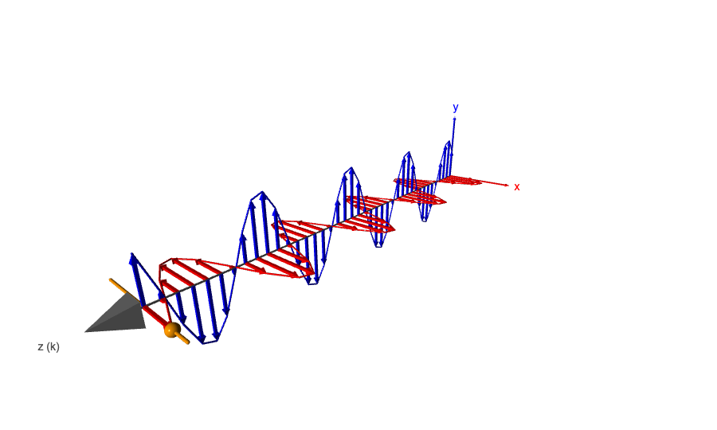
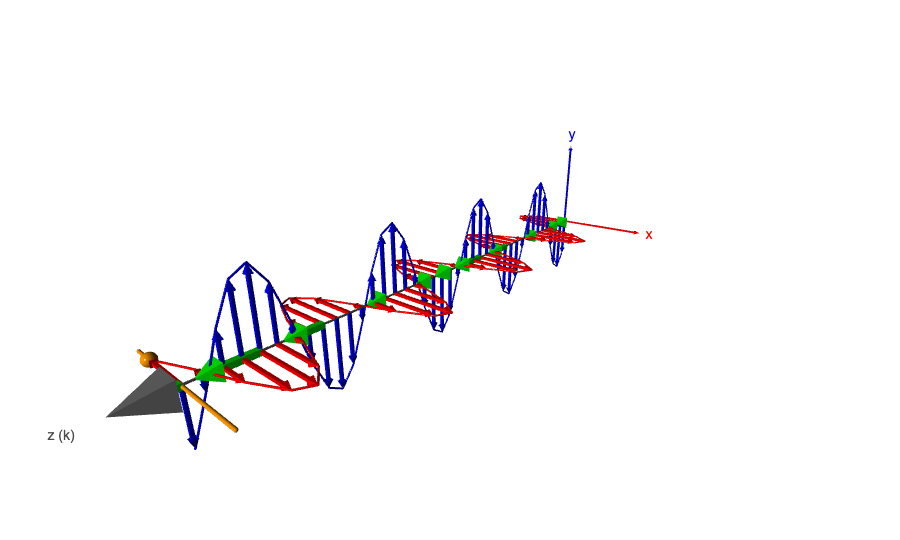
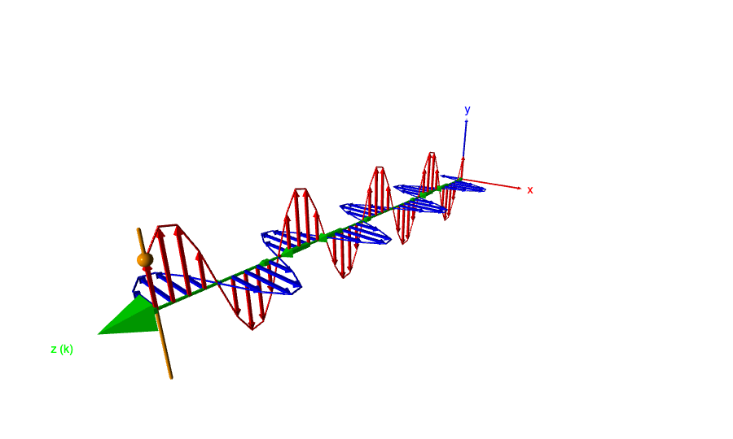
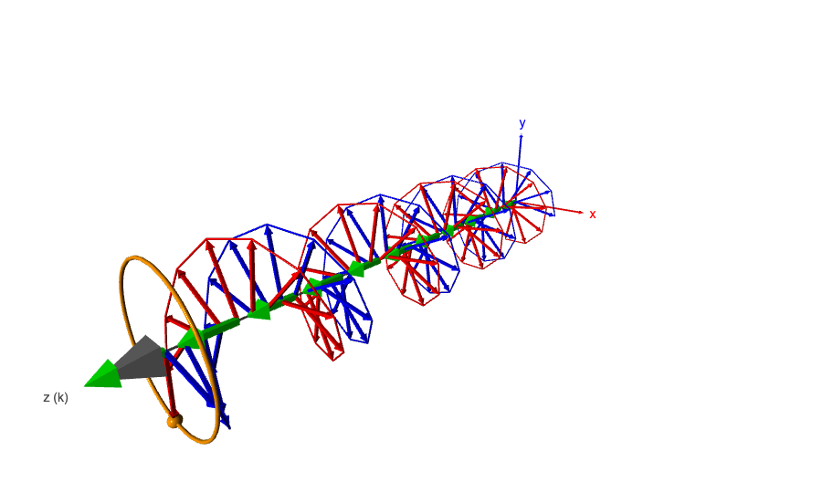
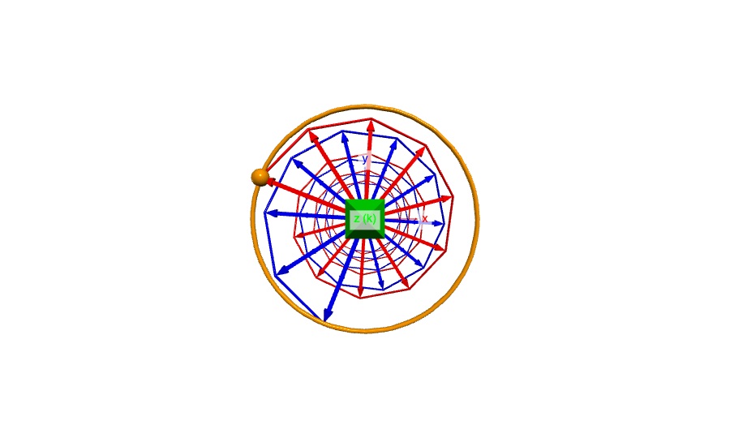
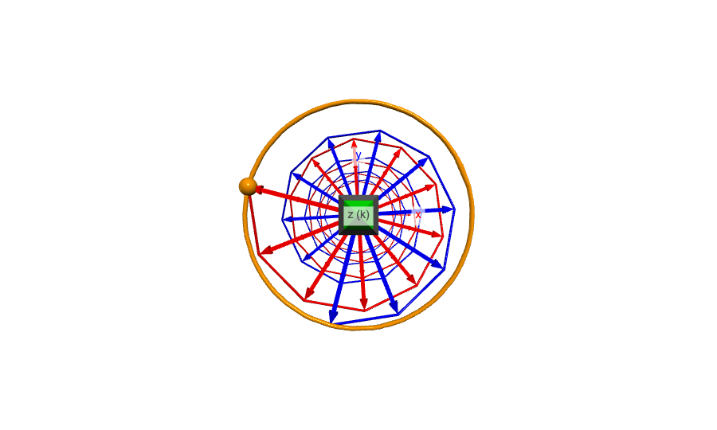
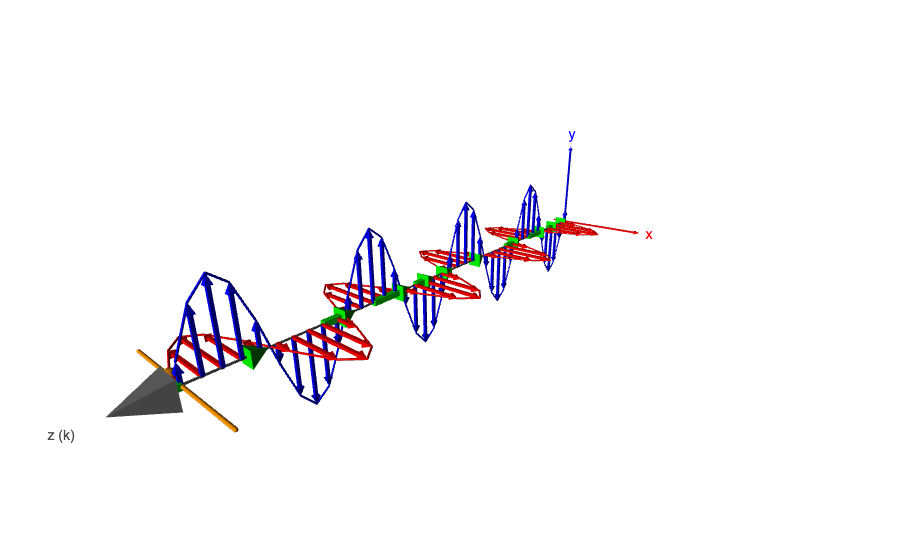
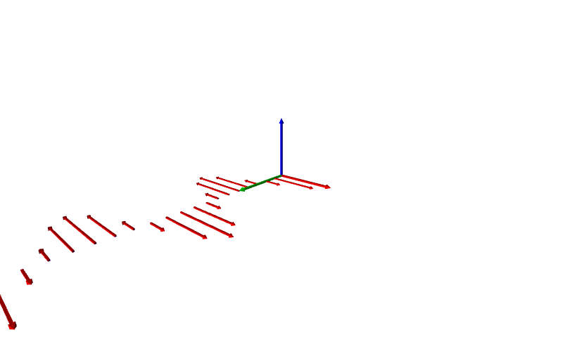

# SCI-103 Physics I — Lab 13

## การจำลองสนามแม่เหล็กไฟฟ้าด้วย VPython

## 1. วัตถุประสงค์

จำลองคลื่นแม่เหล็กไฟฟ้าระนาบเพื่อศึกษาความสัมพันธ์ระหว่างสนามไฟฟ้า **E** สนามแม่เหล็ก **B** ทิศการเคลื่อนที่ของคลื่น และเวกเตอร์พอยน์ติง (Poynting vector) พร้อมเปรียบเทียบโพลาไรเซชันแบบเชิงเส้นและแบบวงกลม

## 2. โปรแกรมจำลอง

โปรแกรมรวม Part A–C ไว้ในไฟล์เดียว โดยเลือกโพลาไรเซชัน ทิศทางการเคลื่อนที่ และความยาวคลื่นได้จากตัวควบคุมบนหน้าจอ

- [โค้ดสำหรับ GlowScript](em_wave_glowscript.py) — คัดลอกทั้งไฟล์ไปวางในโปรแกรมใหม่บน [GlowScript](https://www.glowscript.org/) แล้วกด Run
- [โค้ดสำหรับรันในเครื่อง](em_wave_sim.py) — ติดตั้ง VPython ด้วย `python3 -m pip install vpython` แล้วรัน `python3 em_wave_sim.py`

ยังไม่มี URL ของโปรแกรมที่เผยแพร่บน GlowScript สำหรับรายงานฉบับนี้

## 3. ทฤษฎีและค่าที่ใช้

คลื่นเดินทางตามแกน z มีเฟส

$$
\phi = kz - s\omega t,\qquad k=\frac{2\pi}{\lambda},\qquad \omega=ck
$$

โดย `s = +1` หมายถึงคลื่นเดินทางไปทาง `+z` และ `s = −1` หมายถึงคลื่นเดินทางไปทาง `−z` สำหรับคลื่นแม่เหล็กไฟฟ้าในสุญญากาศ

$$
\mathbf{B}=\frac{\hat{\mathbf{k}}\times\mathbf{E}}{c},
\qquad
\mathbf{S}=\frac{\mathbf{E}\times\mathbf{B}}{\mu_0}
$$

ดังนั้น **E**, **B** และทิศการเคลื่อนที่ตั้งฉากกัน และ `E × B` ชี้ไปตามทิศการเคลื่อนที่ของคลื่น

โปรแกรมใช้ `c = 1` เป็นหน่วยแสดงผล เพื่อให้เห็นสนามทั้งสองและการเคลื่อนที่ได้ชัดเจน ค่านี้เป็นการปรับสเกล ไม่ใช่การเปลี่ยนความสัมพันธ์ของสนามในทฤษฎี

| ปริมาณ | ค่าจำลองเริ่มต้น | ความหมาย |
|---|---:|---|
| `c` | 1 | อัตราเร็วคลื่นในหน่วยแสดงผล |
| `E₀` | 1 | แอมพลิจูดสนามไฟฟ้า |
| `B₀ = E₀/c` | 1 | แอมพลิจูดสนามแม่เหล็กในหน่วยแสดงผล |
| `λ` | 2 | ความยาวคลื่น ปรับได้ตั้งแต่ 1 ถึง 4 |
| `f = c/λ` | 0.5 | ความถี่ |
| `ω = 2πf` | `π ≈ 3.142` | ความถี่เชิงมุม |
| `T = 1/f` | 2 | คาบ |
| จำนวนจุด / ระยะห่าง | 41 / 0.2 | ช่วงที่แสดงยาว 8 หน่วย หรือ 4 ความยาวคลื่นเมื่อ `λ = 2` |

## 4. ผลการจำลอง

### Part A — คลื่นแม่เหล็กไฟฟ้าเชิงเส้น

สำหรับโพลาไรเซชันตามแกน x:

$$
\mathbf{E}=E_0\cos\phi\,\hat{\mathbf{x}},\qquad
\mathbf{B}=s\frac{E_0}{c}\cos\phi\,\hat{\mathbf{y}}
$$

สนามทั้งสองมีเฟสเดียวกัน และตั้งฉากกับกันและกันรวมถึงทิศการเคลื่อนที่

*รูปที่ 1 สนามไฟฟ้า (แดง) สนามแม่เหล็ก (น้ำเงิน) และแนวการเคลื่อนที่ตามแกน z*

### Part B — เวกเตอร์พอยน์ติง

สำหรับคลื่นเชิงเส้นที่เคลื่อนที่ไปทาง `+z`:

$$
\mathbf{S}=
\frac{E_0B_0}{\mu_0}\cos^2\phi\,\hat{\mathbf{z}}
$$

โปรแกรมวาดลูกศร **S** สีเขียวให้มีความยาวแปรผันตาม `|E × B|` โดยตัดตัวประกอบ `1/μ₀` ออกเพื่อให้เห็นบนหน้าจอ ลูกศรจึงชี้ไปตามทิศการเคลื่อนที่ และความยาวเปลี่ยนตามเฟสของคลื่น

*รูปที่ 2 เวกเตอร์พอยน์ติงชี้ตามทิศที่คลื่นและพลังงานเคลื่อนที่*

### Part C — โพลาไรเซชัน

โปรแกรมมีโหมด Linear (x), Linear (y), Circular RH และ Circular LH สำหรับคลื่นที่เคลื่อนที่ไปทาง `+z` ตัวอย่างสมการสนามไฟฟ้า ได้แก่

$$
\mathbf{E}_{\text{linear-y}}=E_0\cos\phi\,\hat{\mathbf{y}}
$$

$$
\mathbf{E}_{\text{circular}}=
E_0\left(\cos\phi\,\hat{\mathbf{x}}\pm\sin\phi\,\hat{\mathbf{y}}\right)
$$

ในกรณีเชิงเส้น ปลายเวกเตอร์ **E** เคลื่อนที่กลับไปมาตามเส้นตรง ส่วนกรณีวงกลมปลาย **E** หมุนเป็นวงกลมโดยมีขนาดคงที่ การเรียก RH/LH ขึ้นกับข้อตกลงเรื่องทิศที่ใช้มองคลื่น ในโปรแกรมนี้ใช้ข้อตกลงตามที่ระบุในภาพด้านล่าง

*รูปที่ 3 โพลาไรเซชันเชิงเส้นตามแกน y*

*รูปที่ 4 โพลาไรเซชันวงกลม: สนามเปลี่ยนทิศตามตำแหน่งบนแกน z*

| Circular RH — มองหันหน้าเข้าหาคลื่น | Circular LH — มองหันหน้าเข้าหาคลื่น |
|---|---|
|  |  |

*รูปที่ 5 วิถีของปลายเวกเตอร์ E เมื่อมองตามแนวการเคลื่อนที่*

### การเคลื่อนที่ไปทาง −z

เมื่อเลือกทิศ `−z` โปรแกรมกลับทิศของสนามแม่เหล็กตาม `B = k̂ × E/c` ทำให้ `E × B` ชี้ไปทาง `−z` เช่นเดียวกับทิศการเคลื่อนที่

*รูปที่ 6 เมื่อคลื่นเคลื่อนที่ไปทาง −z เวกเตอร์พอยน์ติงก็ชี้ไปทาง −z*

## 5. อภิปรายผล

ผลจำลองสอดคล้องกับสมการของคลื่นแม่เหล็กไฟฟ้า: **E** และ **B** ตั้งฉากกันและตั้งฉากกับทิศการเคลื่อนที่ อีกทั้งมีเฟสตรงกันในคลื่นระนาบเชิงเส้น เมื่อคำนวณ `E × B` จะได้เวกเตอร์พอยน์ติงไปในทิศเดียวกับคลื่นทั้งกรณี `+z` และ `−z`

สำหรับโพลาไรเซชันเชิงเส้น ขนาดของ **E** และ **B** เปลี่ยนแปลงตามเวลา ทำให้ขนาดของ **S** เปลี่ยนตาม `cos²φ` สำหรับโพลาไรเซชันวงกลม องค์ประกอบสนามสองแกนต่างเฟสกัน 90° ทำให้ขนาดของ **E** คงที่ และขนาดของ **S** คงที่ในแบบจำลอง

การใช้ค่าจริงในหน่วย SI โดยตรงไม่เหมาะกับการแสดงผลบนจอ: เมื่อ `E₀ = 1 V/m` จะได้ `B₀ = E₀/c ≈ 3.34×10⁻⁹ T` ซึ่งเล็กมากเมื่อเทียบกับสนามไฟฟ้า อีกทั้งความถี่ของคลื่นที่มี `λ = 2 m` จะเป็น `1.5×10⁸ Hz` การแสดงภาพจึงใช้หน่วยจำลอง `c = 1` เพื่อให้สเกลและอัตราการเคลื่อนที่มองเห็นได้

*รูปที่ 7 ตัวอย่างการแสดงผลที่เห็นสนามแม่เหล็กได้ยากเมื่อใช้สเกล SI โดยตรง*

## 6. คำถามท้ายการทดลอง

**1. ทิศของ E, B และคลื่นสัมพันธ์กันอย่างไร?**

เวกเตอร์ทั้งสามตั้งฉากกัน โดย `E × B` ชี้ไปตามทิศการเคลื่อนที่ของคลื่น

**2. E และ B มีความสัมพันธ์ทางเฟสอย่างไร?**

สำหรับคลื่นระนาบในสุญญากาศ สนามทั้งสองมีเฟสตรงกัน และมีอัตราส่วนแอมพลิจูด `E₀/B₀ = c`

**3. เวกเตอร์พอยน์ติงบอกอะไร?**

`S = E × B/μ₀` บอกทิศและอัตราการถ่ายโอนพลังงานต่อหนึ่งหน่วยพื้นที่ โดยมีหน่วย `W/m²`

**4. ปลายเวกเตอร์ E ในโพลาไรเซชันวงกลมต่างจากแบบเชิงเส้นอย่างไร?**

แบบเชิงเส้นปลายเวกเตอร์เคลื่อนที่ไปกลับตามเส้นตรง ส่วนแบบวงกลมปลายเวกเตอร์หมุนเป็นวงกลมและขนาดคงที่

**5. ถ้าคลื่นเคลื่อนที่ไปทาง −z ต้องเปลี่ยนอะไร?**

เปลี่ยนทิศการเปลี่ยนเฟสและคำนวณสนามแม่เหล็กจาก `B = k̂ × E/c` โดยใช้ `k̂ = −ẑ` เพื่อให้ `E × B` ชี้ไปทาง `−z`

## 7. ข้อจำกัดและสรุป

โปรแกรมแสดงสนามตามแนวแกน z ด้วยจุดตัวอย่างจำนวนจำกัด และใช้สเกลหน่วยแสดงผลเพื่อให้เห็นภาพ จึงเหมาะสำหรับศึกษาทิศทาง เฟส และรูปแบบของสนาม ไม่ใช่การวัดขนาดสนามจริงจากภาพ การคำนวณในหน่วย SI ต้องใช้ความสัมพันธ์ทางฟิสิกส์และค่าคงที่จริงแยกต่างหาก

การจำลองนี้แสดงให้เห็นว่า **E**, **B** และทิศการเคลื่อนที่สัมพันธ์กันตามกฎมือขวา พลังงานแพร่ไปตามทิศของคลื่น และโพลาไรเซชันกำหนดวิถีของปลายเวกเตอร์สนามไฟฟ้า

## 8. การควบคุมโปรแกรม

| ตัวควบคุม | หน้าที่ |
|---|---|
| Pause / Run | หยุดหรือเริ่มการเคลื่อนที่ |
| Polarization | เลือก Linear (x), Linear (y), Circular RH หรือ Circular LH |
| Propagation | เลือกทิศ `+z` หรือ `−z` |
| Wavelength | ปรับความยาวคลื่นระหว่าง 1 ถึง 4 |
| Show E / B / S | ซ่อนหรือแสดงลูกศรของสนามแต่ละชนิด |
| View: 3D / Face the wave | เปลี่ยนมุมมองเพื่อดูรูปแบบสนามหรือการหมุนของโพลาไรเซชัน |
